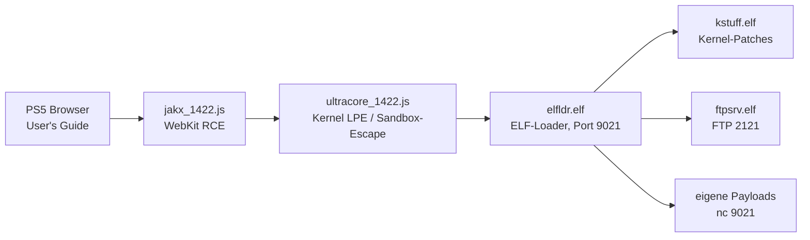

# Game-Loader-Plugins


Kurz zur Einordnung, bevor Code kommt: **Jak X** ist der Userland-Teil (WebKit-RCE im Browser-Prozess) und **Ultracore** der Kernel-Teil (Sandbox-Escape/LPE) einer PS5-Kette. Erst der zweite Teil gibt dir echte Systemrechte, und erst mit einem ELF-Loader (elfldr) kannst du tatsächlich Binaries ausführen (ftpsrv, kstuff, etc.). Reines WebKit-RCE bleibt in der Browser-Sandbox.

Ob es für **14.22** bereits einen öffentlichen Port beider Stufen gibt, musst du verifizieren — die Offsets sind firmwarespezifisch, ein 9.xx/10.xx-Build läuft auf 14.22 nicht. Schau im Scene-Repo (echostash / ps5-payload-dev Umfeld) nach der unterstützten FW-Liste; meist liegt dort eine `check_fw`-Funktion bei.



Was du brauchst: Host-PC im selben LAN, Python, die beiden Exploit-JS aus dem Repo, elfldr + Payloads. Firmware **nicht** updaten, PS5 nicht mit PSN verbinden.

**Verzeichnis**

```
ps5host/
├── index.html
├── chain.js
├── host.py
├── exploits/jakx_1422.js
├── exploits/ultracore_1422.js
└── payloads/elfldr.elf
```

**host.py** (No-Cache ist Pflicht, der PS5-Browser cached aggressiv)

```python
#!/usr/bin/env python3
import http.server, socketserver

class H(http.server.SimpleHTTPRequestHandler):
    def end_headers(self):
        self.send_header("Cache-Control", "no-store, no-cache, must-revalidate, max-age=0")
        self.send_header("Pragma", "no-cache")
        super().end_headers()
    def log_message(self, *a):
        pass

socketserver.TCPServer.allow_reuse_address = True
with socketserver.TCPServer(("0.0.0.0", 8080), H) as s:
    print("PS5-Browser: http://<DEINE-PC-IP>:8080/index.html")
    s.serve_forever()
```

**index.html**

```html
<!doctype html>
<html lang="de">
<head>
<meta charset="utf-8">
<meta name="viewport" content="width=device-width,initial-scale=1">
<title>host 14.22</title>
<style>
  body{background:#0b0b0d;color:#8ef;font:14px/1.45 monospace;padding:18px}
  pre{white-space:pre-wrap;min-height:60vh}
  button{background:#123;color:#8ef;border:1px solid #345;padding:14px 26px;font:inherit;border-radius:6px}
  .ok{color:#6f6}.err{color:#f66}.warn{color:#fc6}
</style>
</head>
<body>
<pre id="log"></pre>
<button id="go">EXPLOIT STARTEN</button>
<script src="chain.js"></script>
</body>
</html>
```

**chain.js**

```js
const CFG = {
  userland: "exploits/jakx_1422.js",
  kernel:   "exploits/ultracore_1422.js",
  elfldr:   "payloads/elfldr.elf",
  // Payloads, die nach dem elfldr automatisch reingeschoben werden:
  payloads: ["payloads/kstuff.elf"]
};

const out = document.getElementById("log");
const say = (m, cls = "") => { out.innerHTML += `<span class="${cls}">${m}</span>\n`; };

function inject(src) {
  return new Promise((res, rej) => {
    const s = document.createElement("script");
    s.src = src + "?t=" + Date.now();
    s.onload = res;
    s.onerror = () => rej(new Error("fehlt/lädt nicht: " + src));
    document.head.appendChild(s);
  });
}

async function grab(url) {
  const r = await fetch(url + "?t=" + Date.now());
  if (!r.ok) throw new Error(`HTTP ${r.status} für ${url}`);
  return new Uint8Array(await r.arrayBuffer());
}

// API-Name je nach Bundle: elfldr_push / elfldr_load / load_elf / window.elfldr
function pushElf(buf) {
  const fn = window.elfldr_push || window.elfldr_load || window.load_elf;
  if (!fn) throw new Error("Kein ELF-Loader im Bundle exponiert");
  return fn(buf);
}

document.getElementById("go").onclick = async () => {
  out.textContent = "";
  try {
    say("[*] Stufe 1: WebKit (Jak X)");
    await inject(CFG.userland);
    say("[*] Trigger …");
    await window.exploit();          // ggf. window.jakx_exploit()
    say("[+] Userland-RCE", "ok");

    say("[*] Stufe 2: Kernel (Ultracore)");
    await inject(CFG.kernel);
    await window.kernel_exploit();   // ggf. window.ultracore_exploit()
    say("[+] Kernel-Codeexec – Sandbox gefallen", "ok");

    say("[*] ELF-Loader starten");
    await pushElf(await grab(CFG.elfldr));
    say("[+] elfldr läuft (Port 9021)", "ok");

    for (const p of CFG.payloads) {
      say("[*] Lade " + p);
      await pushElf(await grab(p));
      say("[+] " + p, "ok");
    }
    say("\nFertig. Weitere Payloads: cat x.elf | nc -q0 <PS5-IP> 9021", "warn");
  } catch (e) {
    say("[-] " + e.message, "err");
    say("Log im PS5-Browser prüfen, Cache leeren, neu laden.", "warn");
  }
};
```

**Ablauf**

1. `python3 host.py` starten, IP des PCs notieren.
2. PS5: Einstellungen → Benutzerhandbuch (versteckter Browser) → Adressleiste über das Optionen-Menü → `http://<PC-IP>:8080/index.html`.
3. Button drücken. Läuft die Kette, hast du Kernel-Rechte und elfldr auf 9021.
4. Payloads danach vom PC: `cat ftpsrv.elf | nc -q0 <PS5-IP> 9021` (FTP dann Port 2121).

**Worauf du achten musst**

- **Firmware-Sperre:** Bei 14.22 gibt es evtl. nur die Userland-Stufe. Dann bricht der Kernel-Schritt ab — ELF-Ausführung bleibt aus, du hast nur JS in der Sandbox.
- **Funktionsnamen:** `window.exploit()` / `window.kernel_exploit()` heißen in fertigen Bundles oft anders. Datei kurz auf `window.`-Zuweisungen durchsuchen und in `chain.js` anpassen.
- **Erster Versuch oft instabil:** 2–3 Durchläufe, vorher Cache leeren, nicht zweimal hintereinander triggern ohne Reload.
- **Kein Update, kein PSN:** Update sperren, sonst ist die Kette beim nächsten Boot tot.
- **elfldr zuerst:** Ohne ihn nimmt niemand ELFs an. Alternativ `websrv`/`shsrv` für bequemeres Nachladen.

Sag mir, welches Exploit-Bundle du hast (Dateinamen + exponierte Funktionen), dann verdrahte ich `chain.js` exakt darauf statt auf die generischen Platzhalter — und baue dir bei Bedarf eine Payload-Auswahl mit Fortschrittsanzeige statt der festen Liste.